# EasyEpi

EasyEpi 是面向流行病学与社会调查的 Windows 桌面应用，集成问卷设计、问卷录入、数据管理、统计分析和 AI 问卷助手。核心业务离线运行；AI 功能仅在用户主动发送时连接所配置的服务。

AI 问卷助手的LLM选用 DeepSeek：服务地址固定为 `https://api.deepseek.com`，（默认LLM模型为 `deepseek-v4.1-flash`）、用户需要手动填写 API Key 。另外，可以通过注册 NCBI 的账号获取 API 以更高效率搜索和获取 Pubmed 信息。

## 开发环境

- Windows 10/11 x64
- Node.js `>=22.12 <25`
- pnpm `>=11 <12`

## 使用

### 用户界面

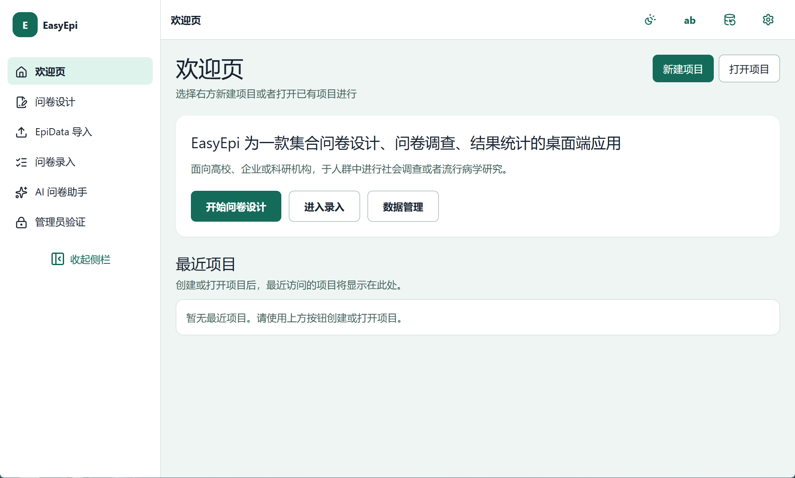

用户通过右上角的`新建项目`或者`打开项目`进行工作：其中首次创建项目需要准备一份密码，以供后面验证。

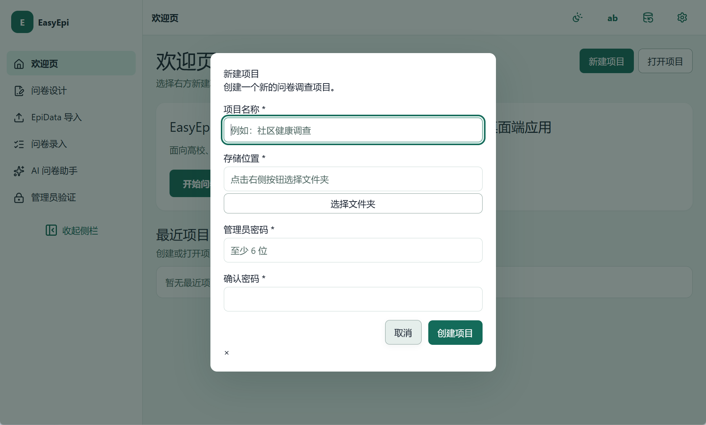

### 问卷设计

主要展示页面：

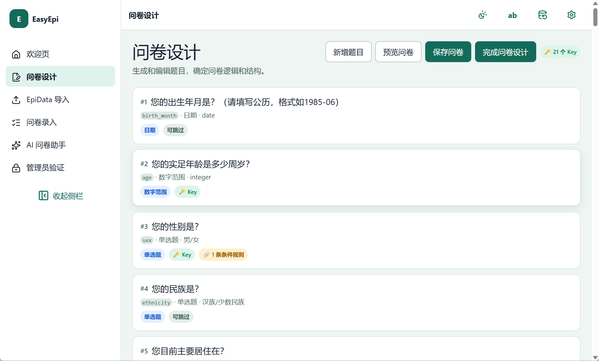

添加题目通过右上角的 `新增题目`实现对应功能：

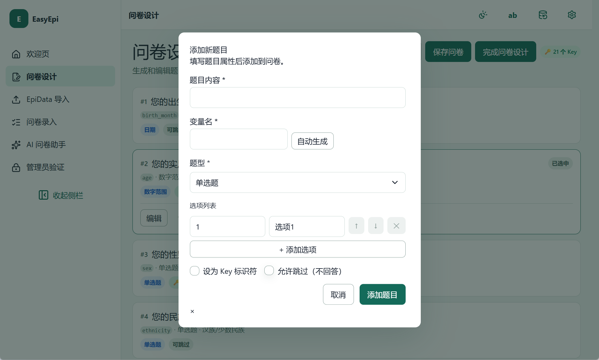

题目类型有单选题、多选题、固定长度填空、自由填空、数字范围填空和日期填空。

题目设定为Key时表示必须填入，通常情况下用于用户识别使用。除此之外，还可以设定条件，在特定时候进行题目的展示和跳跃：

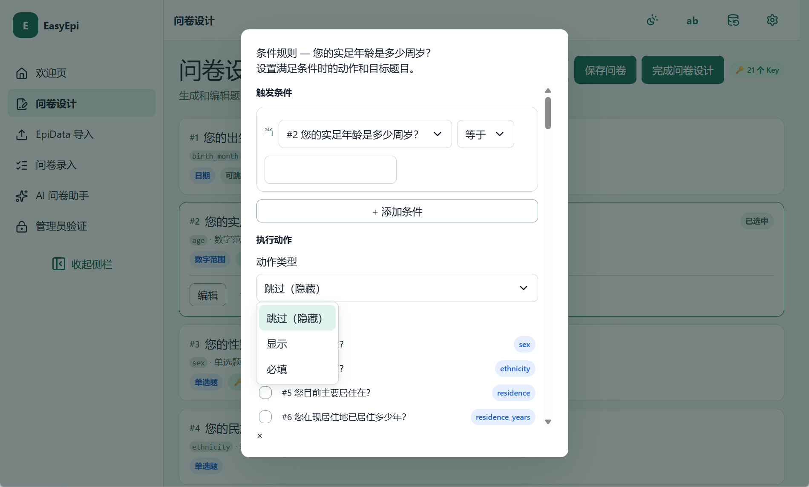

在问卷设计页点击 `问卷导出`，可将当前空白问卷保存为 PDF 或可编辑的 Word（`.docx`）。固定长度题按设定长度绘制空白格，自由填空题保留下划线；单选使用圆形标记，多选使用正方形标记。Key 题干加粗，条件题前注明来源题号、触发条件及显示、跳过或必填动作。

导出不包含录入记录或默认答案。固定长度题每题最多导出 1000 格，整份问卷最多 10000 格，超出时会提示调整，不截断内容。保存时会自动修正扩展名；修正后的文件已存在时，会再次确认是否覆盖。

### EpiData问卷导入

支持Epidata问卷格式`.qes`的导入：

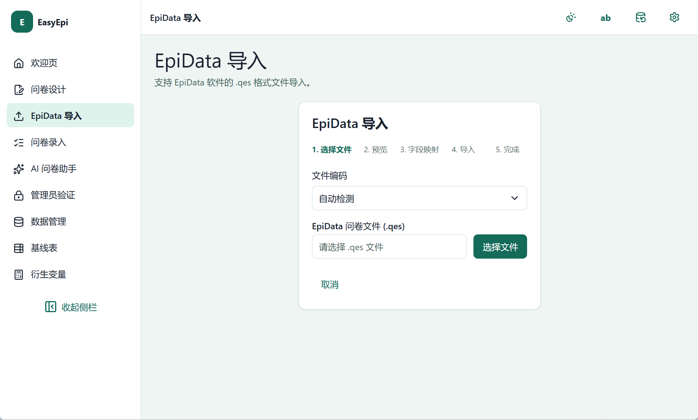

### 问卷录入

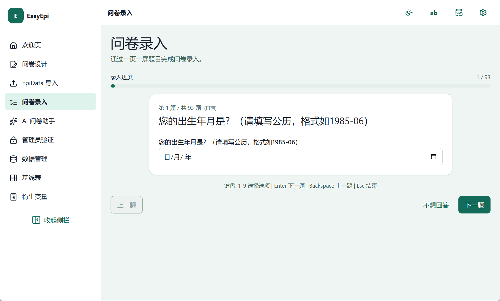

### AI问卷助手

我的提示词为：

```JSON
现在需要你针对医院住院患者的肺癌情况设计一份问卷，包括常用的药物，以及临床诊断TNM分期，还有年龄等基础住院信息，还需要身份证号作为唯一识别号
```

问卷回复信息：

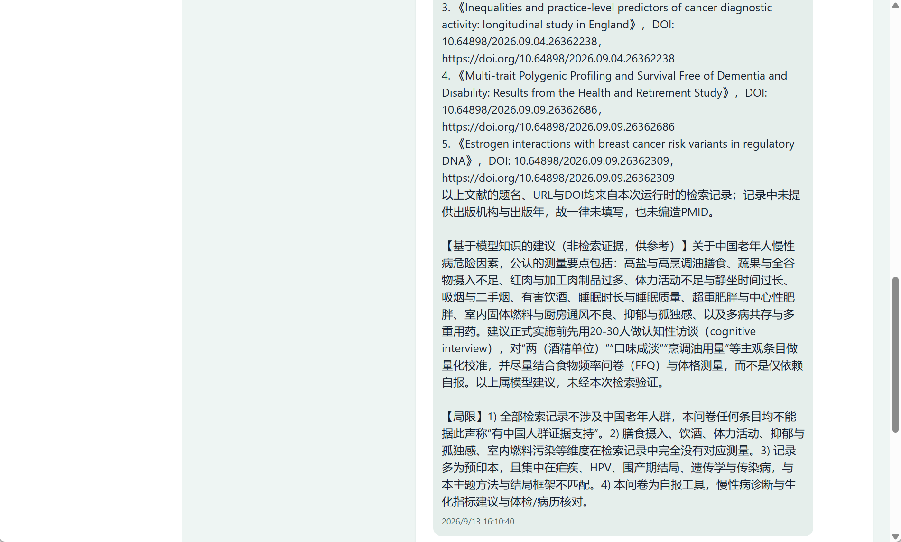

完整回复如下：

```
已根据住院肺癌患者的评估需求生成问卷，覆盖身份识别、基础住院信息、生活方式与暴露史、既往病史与家族史、临床诊断与TNM分期、分子检测、抗肿瘤药物治疗、支持治疗、不良反应及住院结局共十个域。身份证号设为fixed_length类型（约束类型alphanumeric，fixedLength=18），未使用任何正则表达式。

关于证据的说明（检索证据与模型建议需分开看）：本次运行时研究上下文显示检索模式为literature_only，检索说明中明确记录“联网搜索失败，未能补充网络来源”，因此未进行任何网络检索或外部核验，以下内容不得被理解为已完成在线核查。检索到的20条记录以肺癌外科治疗（肺叶切除、胸腔镜手术、术后再入院与复发）为主，因此问卷中“年龄”“性别”“吸烟状况与包年”“合并症”“组织病理学类型”“临床TNM分期”“既往其他恶性肿瘤史”等条目有检索证据支持；而“住院期间系统性抗肿瘤药物及支持治疗药物的名称与方案”“驱动基因（EGFR/ALK/ROS1/KRAS）与PD-L1检测”“职业接触史、二手烟、饮酒、体力活动、膳食、空气污染与厨房油烟、肺结核史、肿瘤家族史、BMI”“药物相关不良反应分级”等条目在检索记录中未见对应数据（证据等级为none或contextual），这些条目是依据该人群常规流行病学与临床评估需要而加入的模型建议条目，用于采集数据，不代表已有文献结论。

主要可核对来源（来源元数据中未提供出版机构名称与DOI，故不列出，统一以PubMed记录编号与链接呈现）：Clinical analysis of 95 cases of pulmonary sarcomatoid carcinoma（PMID 26653560，https://pubmed.ncbi.nlm.nih.gov/26653560/）；Earlier onset and poor prognosis of lung cancer in imprisoned patients（PMID 24335502，https://pubmed.ncbi.nlm.nih.gov/24335502/）；Lobectomy vs. segmentectomy. A propensity score matched comparison of outcomes（PMID 30409440，https://pubmed.ncbi.nlm.nih.gov/30409440/）；Lung cancer and cardiovascular diseases: occurrence, comorbidity and surgical timing（PMID 17410071，https://pubmed.ncbi.nlm.nih.gov/17410071/）；Lung Cancer and Multiple Neoplasms: A Retrospective Analysis（PMID 26987325，https://pubmed.ncbi.nlm.nih.gov/26987325/）；Postoperative recurrence of primary lung cancer: anatomo-clinical and therapeutic study（PMID 35244906，https://pubmed.ncbi.nlm.nih.gov/35244906/）；Unexpected readmission after lung cancer surgery: A benign event?（PMID 26410004，https://pubmed.ncbi.nlm.nih.gov/26410004/）；Development and Validation of a Prognostic Survival Model With Patient-Reported Outcomes for Patients With Cancer（PMID 32236529，https://pubmed.ncbi.nlm.nih.gov/32236529/）。上述记录均提醒：抗肿瘤药物名称、剂量与方案，以及药物相关不良反应分级在本目标人群中证据不足，正式使用前建议由临床药师与肿瘤科医师按本机构实际用药目录核对选项清单。
```

其设计好的问卷支持一键导入并支持后续修改：

### 管理员功能：

因为在实际上，我们在问卷设计好给现场工作人员录入后，我们不想让他人直接看到之前的数据或者导出数据，因此需要管理员的二重验证，在登陆后台后，可以看到数据的情况

首先是数据表格，在这里可以看到所有登记信息情况：

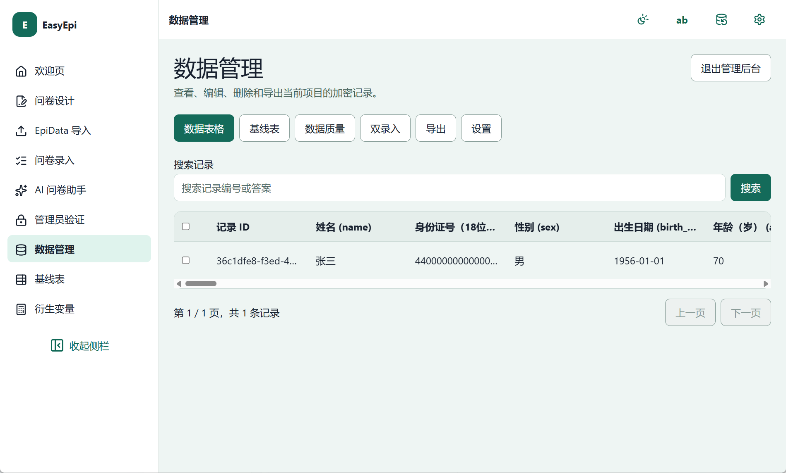

在数据质量页可以看到所有回答的情况，以及每道题的完成情况，同时还可以生成基线表对数据进行初步的统计、数据质量的监测、支持问卷的双录入、问卷数据的导出（支持`.csv`格式）、修改管理员密码。

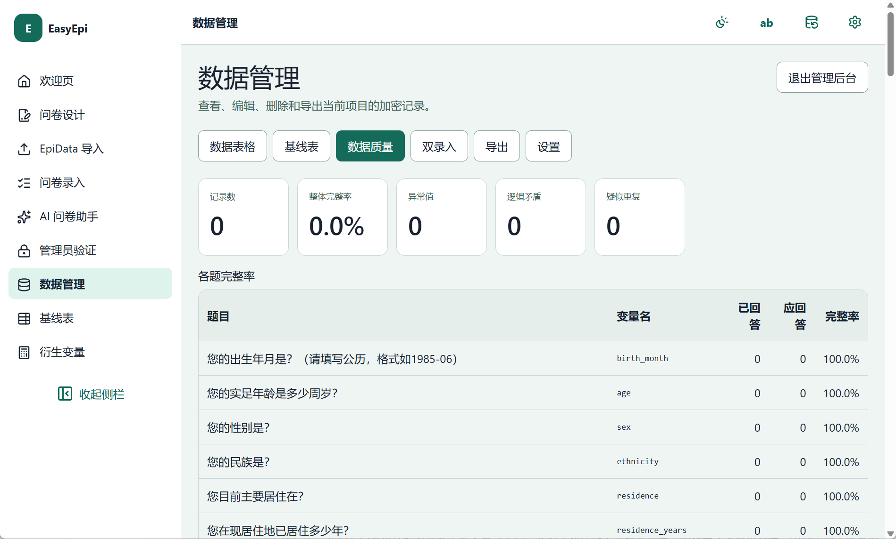

支持衍生变量的计算：且支持多种运算方式，比如类似于LaTeX的表示符也可以直接进行点击的计算操作

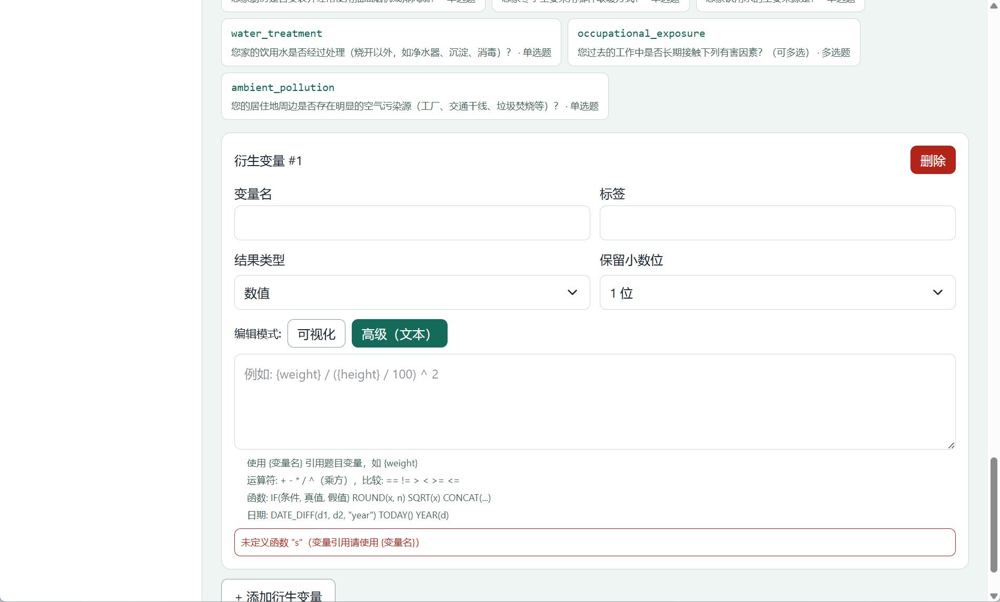

### 问卷导出：

v1.0.0版本支持问卷导出功能，详情页面在问卷设计，支持`pdf`和`doc`两种格式输出：
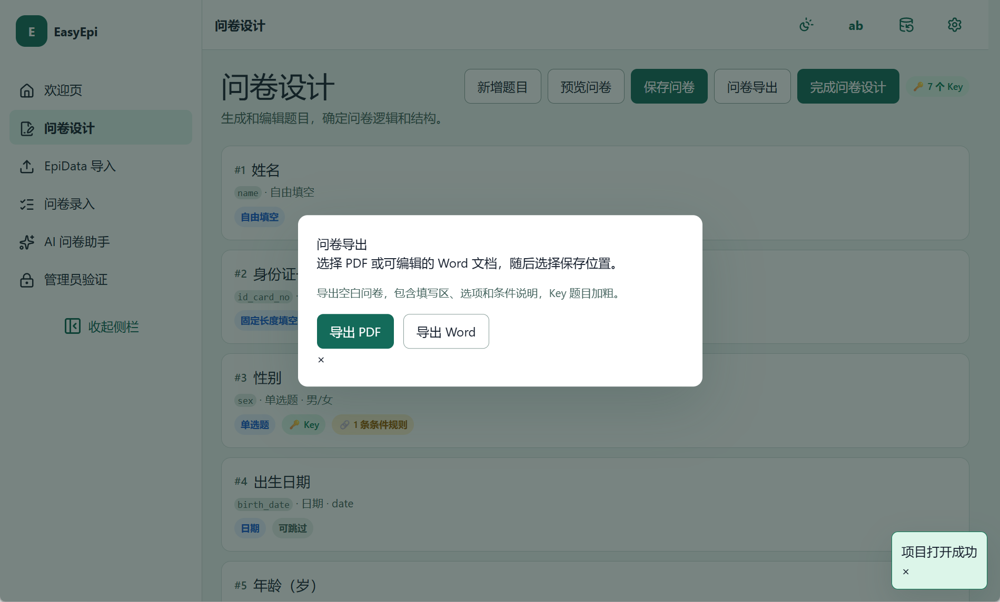

输出pdf的浏览如下：

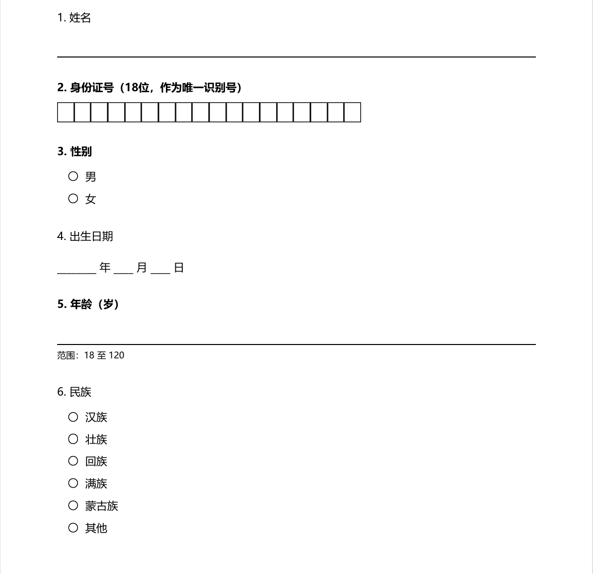

### 其他特性：

黑夜模式：

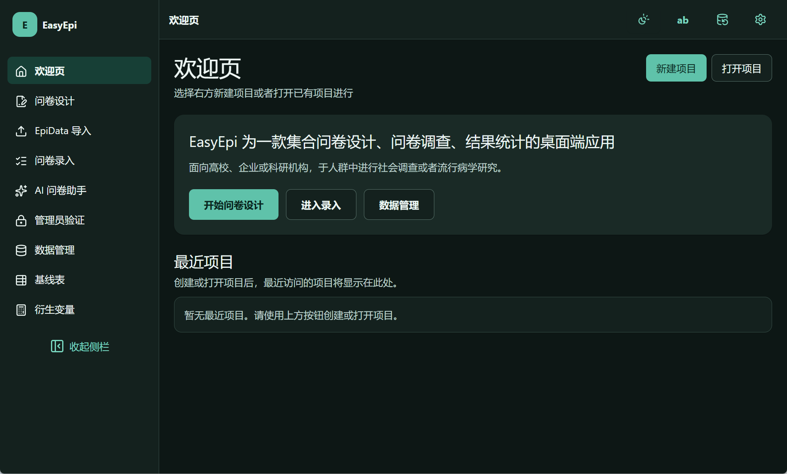

更大的字体：

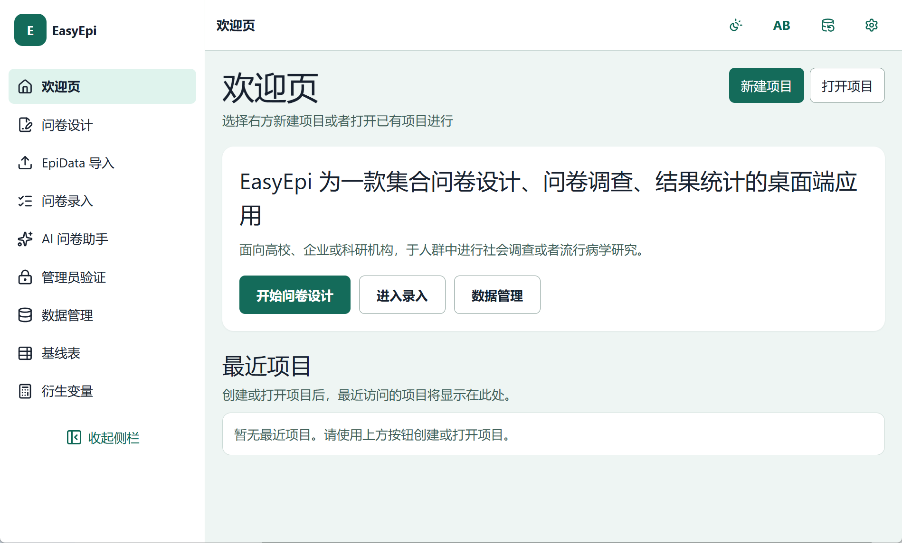

备份与恢复：

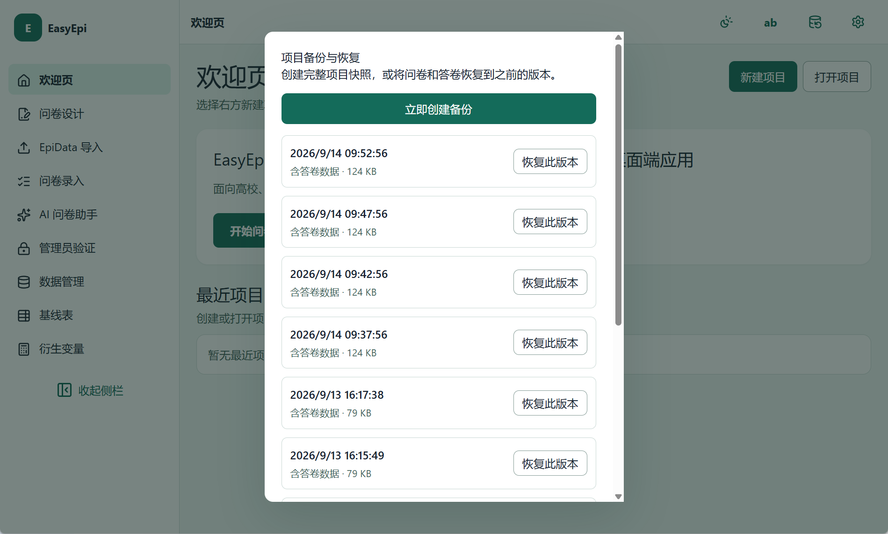

AI设置：API输入与模型选择

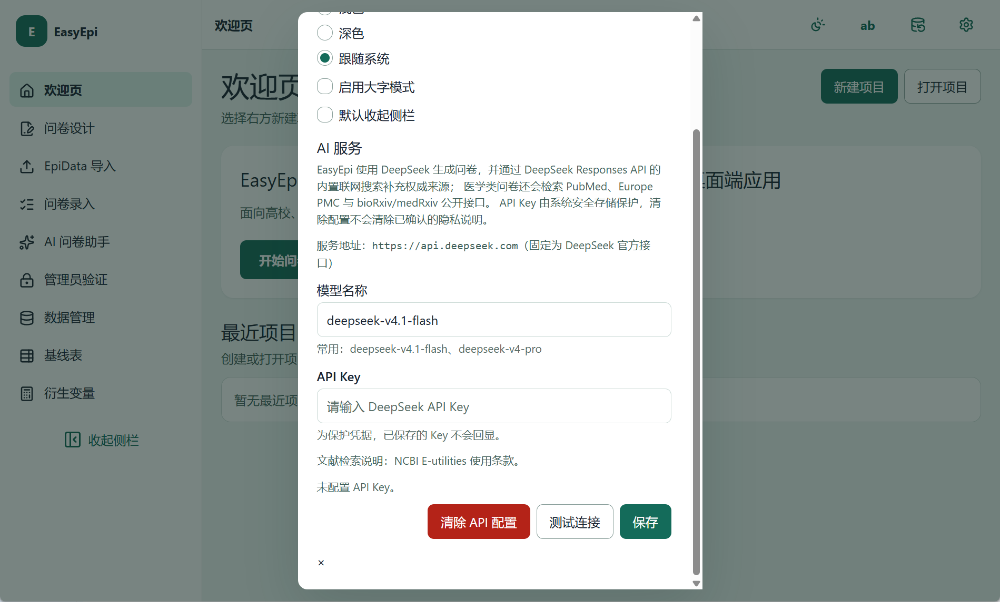

## 其余信息

版本号： 1.0.0

制作人： Jiahao Lin

[个人主页](kokuyublog.com)：内涵更多统计等方面学习资料
